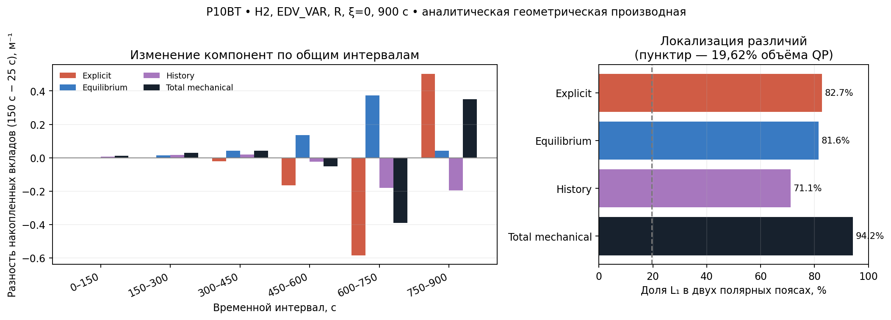
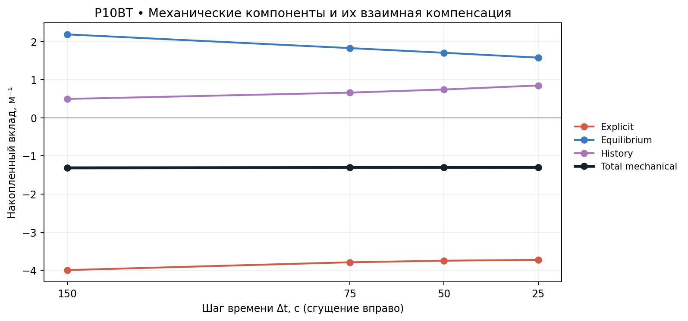

# P10BT — независимый аудит временных компонент производной формы по четырём полным CSV

**Дата:** 19.11.2026. **Статус:** независимая обработка архивных первичных чисел, без МКЭ, сборки, повторного Windows-экспорта и изменения исходных файлов. **Постановка:** H2, EDV_VAR, R, ξ=0, jpeak, область B6, окно расстояний 0,020–0,100 мм, горизонт 900 с, шаги 150/75/50/25 с; аналитические геометрические производные Tet10. Прямая и сопряжённая задачи в каждом исходном FEM выполнены на одной H2 (P10AO).

## 1. Первичные доказательства и контроль

Ранее переданный пользователем оригинал **P10BS_EVIDENCE.zip**: 1 144 881 байт, SHA-256 `66fc611b39f9a04c05a74d79301cf5a8162826ca1b6ed8717126f090dff34e5d`. Архив ZIP прошёл полную проверку 5/5 членов. Содержит неизменённый `P10BS_RESULT.txt` и четыре исходных файла:

| Исходный файл | Строк | SHA-256 |
|---|---:|---|
| `DT150_P10BD_QP_POLAR_RADIAL.csv` | 1200 | `4652c2def95ec28d36ca68315e18271a9de147560a90f13b012005358aafebd3` |
| `DT75_P10BD_QP_POLAR_RADIAL.csv` | 2400 | `81d6e884df060ce582075826380ad2e18f0a1c6c1d562e643023c01152cea64f` |
| `DT50_P10BD_QP_POLAR_RADIAL.csv` | 3600 | `aa8d9f8ca21a0502f51ba6b1f6f7dc5020b5ebad8e014cb6b1f5fa733abb9bd9` |
| `DT25_P10BD_QP_POLAR_RADIAL.csv` | 7200 | `7c6cbb9d7fd68aec1ac07d4530efa73073fee4e7cf6aed7811ec594969ae29a6` |

Полученный отчёт `RESULT=P10BS_FOUR_EXISTING_RAW_POLAR_CSV_READY_NO_FEM`; все четыре preflight и неизменность SHA подтверждены. Наличие этих данных *не* доказывает SHA исходного исторического P10BE_H2 EXE (`UNKNOWN`).

Проверяющий код: [`scripts/p10bt_temporal_component_audit.py`](../scripts/p10bt_temporal_component_audit.py), результат `P10BT_INDEPENDENT_READ_ONLY_COMPONENT_AUDIT_OK`. Скрипт повторно вычисляет SHA, проверяет:

1. 200 уникальных ячеек на каждом из 6/12/18/36 шагов, единый физический горизонт 900 с, отсутствие пропусков/дубликатов, совпадающие физические ключи.
2. `positive_qp + negative_qp = qp_count`; на каждом шаге/в каждом dt неизменные **9147 QP** и физический объём `1.137000795315382·10⁻⁹ м³` в выбранных двух оболочках. Для двух крайних полярных поясов — **1783 QP (19,4927%)** и **19,6219%** этого объёма. Не суммировать QP-объём по временным шагам как физический объём!
3. Поклеточные балансы `explicit + equilibrium + history = total_mechanical` и `positive_mechanical + negative_mechanical = total_mechanical`; `history=0` на терминальном шаге во всех четырёх сетках времени.
4. Равенство четырёх накопленных механических сумм двух оболочек с ранее опубликованным `P10BE_TEMPORAL_SUMMARY.csv` и совпадение **всех 800** накопленных поклеточных значений с четырьмя столбцами `P10BE_CELL_TEMPORAL_COMPARE.csv`; глобальное `mechanical + thermal = total`.

Ни температурные QP-поля, ни локальные составляющие тепловой производной в полученных файлах не содержатся; они не восстанавливались.

## 2. Новая покомпонентная декомпозиция во времени

Сумма по всем шагам и 200 ячейкам в 0,020–0,100 мм, единицы **м⁻¹**:

| Δt, с | Explicit | Equilibrium | History | Всего, механика |
|---:|---:|---:|---:|---:|
| 150 | −3,994139700390 | +2,186337682101 | +0,493976552428 | −1,313825465861 |
| 75 | −3,789780668692 | +1,827183207047 | +0,659189690325 | −1,303407771319 |
| 50 | −3,748093426156 | +1,704388812326 | +0,741523842389 | −1,302180771441 |
| 25 | −3,726469443737 | +1,577250219177 | +0,846815982814 | −1,302403241746 |

На переходе 150−25 с:

\[
\Delta M_{\rm explicit}=-0.267670256654,\quad
\Delta M_{\rm equilibrium}=+0.609087462924,\quad
\Delta M_{\rm history}=-0.352839430386,
\]
\[
\Delta M_{\rm near}=-0.011422224115\ \text{м}^{-1}.
\]

Сумма модулей **трёх знаковых разностей** = 1,229597150 м⁻¹, в **107,65 раза** превосходит модуль их суммы. Сумма **поклеточных** L1-разностей трёх компонентов = 1,756938088181 м⁻¹, а поклеточное L1-различие объединённой механики = 0,125791599506 м⁻¹ (**фактор 13,967**). Это два разных определения компенсации, их нельзя подменять друг другом.

| Сравнение | Компонента | Разность сумм, м⁻¹ | Поклеточная L1, м⁻¹ | Доля L1 в полярных поясах |
|---|---|---:|---:|---:|
| 150−25 | Explicit | −0,267670257 | 0,408864067 | 82,7334% |
| 150−25 | Equilibrium | +0,609087463 | 0,844186888 | 81,5595% |
| 150−25 | History | −0,352839430 | 0,503887133 | 71,0625% |
| 150−25 | **Суммарная механика** | **−0,011422224** | **0,125791600** | **94,2434%** |
| 50−25 | Explicit | −0,021623982 | 0,066643017 | 66,2329% |
| 50−25 | Equilibrium | +0,127138593 | 0,194979712 | 77,8529% |
| 50−25 | History | −0,105292140 | 0,150492718 | 71,0865% |
| 50−25 | **Суммарная механика** | **+0,000222470** | **0,022749654** | **94,4512%** |

**На фиксированной H2** распределение числа QP и их объёмов по ячейкам полностью совпадает между всеми четырьмя временны́ми шагами. Поэтому изменение перечисленных механических компонент *не является следствием разного количества QP или их геометрических объёмов в этой H2-серии*. Этим не исключены чувствительность состояния/адъюнкта к dt, особенности временной квадратуры, реологии, нормировки peak-функционала или иные численные причины.

## 3. Вторая компенсация — между одинаковыми физическими интервалами времени

Чтобы не сопоставлять разные порядковые номера шага напрямую, каждое dt было просуммировано по **шести общим интервалам по 150 с**. Число исходных шагов в каждом интервале: 1/2/3/6 при dt=150/75/50/25 соответственно. Для механической суммы разность накопленных вкладов **150−25**:

| Физический интервал | Δ механики, м⁻¹ | Поклеточная L1, м⁻¹ |
|---|---:|---:|
| (0;150] с | +0,010415410 | 0,013021231 |
| (150;300] с | +0,030375367 | 0,038140666 |
| (300;450] с | +0,041070452 | 0,052939262 |
| (450;600] с | −0,052265220 | 0,054338686 |
| (600;750] с | **−0,390801024** | **0,435299296** |
| (750;900] с | **+0,349782791** | **0,374194740** |
| **Сумма** | **−0,011422224** | *не равна итоговой поклеточной L1* |

Сумма модулей шести **знаковых интервальных** разностей = 0,874710263 м⁻¹, в **76,58 раза** больше модуля общей разности. А сумма интервальных поклеточных L1 = 0,967933881 м⁻¹ не равна L1 разности после суммирования по времени, потому что знаки локальных изменений могут меняться между интервалами.

**Наблюдение:** сильное перераспределение возникает в основном на поздних участках 600–900 с, причём большие разности двух соседних интервалов имеют противоположные знаки. Это ещё не доказательство локальной динамической неустойчивости: величины относятся к разложению полной сопряжённой производной по шагам и зависят от всей истории.





## 4. Границы научного вывода и следующий минимальный шаг

**Подтверждено:** (a) механическая сумма в двух оболочках относительно мало изменяется между dt50 и dt25 на фоне крупных изменений каждого слагаемого; (b) компенсация действует одновременно между тремя компонентами, пространственными ячейками и разными частями временного интервала; (c) локализация итоговой разности в полярных поясах не объясняется перераспределением числа/объёма QP на *той же* H2; (d) накопленная `history` существенно меняется с dt, хотя на терминальном шаге равна нулю по конструкции обратного прохода.

**Не доказано:** временной асимптотический порядок, пространственная сходимость **полной** `D_R jpeak`, физическая причина полярной концентрации, погрешность истинной непрерывной производной, локальный тепловой вклад и происхождение исторического P10BE_H2 EXE. Не считать близость сумм признаком сходимости каждого слагаемого; не переносить H2 временные величины на H4 пространственную серию.

**Следующий минимальный этап (P10BU, только чтение исходников):** установить по точным опубликованным файлам конструкцию временных весов `jpeak` (включая конечный шаг), переменные обратного прохода и рекуррентное накопление `history`, а также определение `explicit/equilibrium` на каждом шаге. Сопоставить обнаруженное позднее изменение знака с математической формулой программного разложения и выделить один проверяемый критерий правильности реализации. Только после него решать, необходим ли новый узкий диагностический экспорт T/thermal shape либо адресный FEM с контролем времени и ресурсов. Сейчас новых Windows запусков не требуется.

**Воспроизводимость:** файл `research/evidence/P10BT_H2_TEMPORAL_20261119/derived/P10BT_RESULT.txt` с исходными SHA и итоговым маркером; в том же каталоге `P10BT_COMPONENT_TOTALS.csv`, `P10BT_COMPONENT_PAIRS.csv`, `P10BT_POLAR_COMPONENTS.csv`, `P10BT_RADIAL_COMPONENTS.csv`, `P10BT_ALIGNED_WINDOWS.csv`, `P10BT_STEP_SERIES.csv`. Скрипт только читает оригинальные входные файлы, записывает новые производные CSV отдельно. Новых N-статусов не вводится.

Запуск независимой проверки из корня клона исследовательской ветки (Python 3, стандартная библиотека):

```bash
python3 scripts/p10bt_temporal_component_audit.py --input-dir research/evidence/P10BT_H2_TEMPORAL_20261119/input --summary research/evidence/P10BE_H2_20261118/input/P10BE_TEMPORAL_SUMMARY.csv --cells research/evidence/P10BE_H2_20261118/input/P10BE_CELL_TEMPORAL_COMPARE.csv --output-dir research/evidence/P10BT_H2_TEMPORAL_20261119/derived
```

Для двух PNG дополнительно нужен matplotlib: `python3 scripts/p10bt_plot.py`. Скрипты не запускают FEM, Git или компилятор и не изменяют первичные данные.
