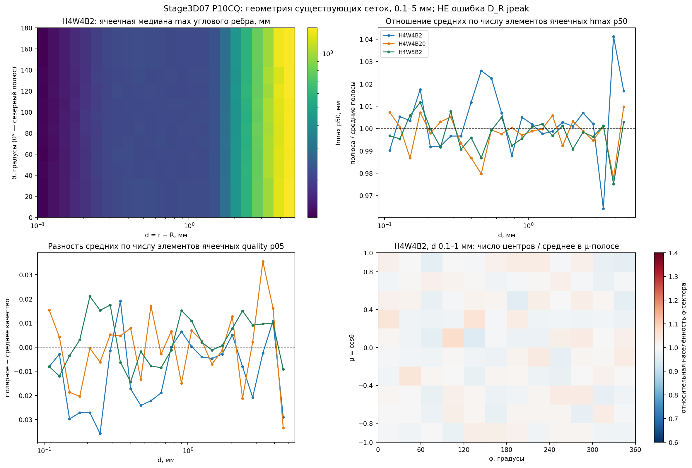

# Stage3D07 / P10CQ — независимая проверка P10CP на реальных сетках B6: размеры, качество и приполюсное сравнение

**21.11.2026. Итог:** `P10CQ_INDEPENDENT_P10CP_EVIDENCE_AUDIT_OK_NO_FEM`. Получен оригинальный `P10CP_EVIDENCE.zip` SHA-256 `20907ff41f5061d72cd5e07ddcce3fc54824ca0a57dcd33e7ef08696a2587725`. Это **новые фактические Windows результаты P10CP**, в отличие от прежнего статуса PREPARED. Самих трёх сырых `.msh` в среде ассистента всё ещё нет: их SHA-256 gate и выполнение 27.169 с подтверждены исходным Windows отчётом, а **содержимое архива CSV проверено независимо**. Физический FEM/Gmsh не запускался программой P10CP согласно её отчёту; ассистент не наблюдал Windows процесс непосредственно.

## 1. Исходные доказательства и независимые контрольные суммы

- [Оригинальный Windows P10CP ZIP](evidence/P10CP_WINDOWS_B6_MESH_PROFILE_20261121/input/P10CP_EVIDENCE.zip): 5/5 CRC PASS, файлов ровно 5, без `.msh`, `.exe`, bin, локальных журналов среды пользователя. `RESULT=P10CP_ORIGINAL_B6_MESH_PROFILE_OK_NO_FEM`; `PINNED_RAW_MESH_SHA256=PASS_3_OF_3`; `NODE_TET10_CATEGORY_COUNTS=PASS_3_OF_3`; `TET10_RADIAL_MU_PHI_PARTITION=PASS_3_OF_3`. Исходный `WALL_SECONDS=27.169` — показание Windows отчёта.
- P10CP source `P10CP_MESH_SUMMARY.csv` SHA `c40173e81a71a9b6c2ab5b3dc392be0bbf8460bf92b73d7631b1682cffaaa36e`; `P10CP_MERIDIONAL_720CELL_PROFILE.csv` SHA `8bc7b0a2b7484bd93bd59b49f7f2acdae9fe1229bb87fef8814016c4a647be5b`; `P10CP_3D_8640CELL_PROFILE.csv` SHA `eb50a1e53dd852c4539159a35af35a6db806d996744ab702b13e3bae05c60fa3`. Все 3/3 SHA проверены независимо по исходному ZIP и манифесту.
- Перекрёстная независимая сверка **с оригинальным** P10CI `P10CI_MESH_COUNTS.csv` SHA `4c6da8910f96eacd75179c0415197cd0c5b47fafca77b07e212561aea844b788`: точные mesh SHA/узлы/Tet10/четыре категории совпали 3/3.
- 3×24×10=**720** meridional `(d,μ)` строк и 3×24×10×12=**8640** spatial `(d,μ,φ)` строк. Каждый ключ неповторяющийся, все ячейки 24×10×12 заполнены или явно пусты; фактически все 8640 имеют положительный счётчик. По **каждой** из 720 пар `(mesh,d,μ)` сумма 12 φ-секторов точно восстанавливает число Tet10 и все целочисленные счётчики; максимум расхождения суммы округлённых угловых объёмов относительно меридионального итога `4.3513×10⁻¹²`. Проверены корректные границы `d,μ,φ`, физически допустимые corner-quality/edge quantiles и отсутствие NaN.

## 2. Геометрическое наблюдение 0,1–5 мм

Полярные полосы: `μ∈[-1,-.8)∪[.8,1]`, это ровно 20% телесного угла; средние полосы: остальные 80%. Значения ниже являются **средними по числу corner-centroid Tet10 от ячеечных перцентилей** (а не pooled median/pooled p05 individual edges). Область — только **100 мкм – 5 мм**; локальная ранее выявленная полярная концентрация signed derivative преимущественно в **20–100 мкм** непосредственно не проверялась.

| Mesh | Tet10 в 100мкм–5мм | Доля центров в двух полярных поясах | hmax p50: полюса / средние | Quality p05 полюса / средние | Угловые тетраэдры с вершиной вне назначенного d-bin | φ-sector count CV |
|---|---:|---:|---:|---:|---:|---:|
| H4W4B2 | 192565 | 20.0234% | **1.001510** | 0.591140 / 0.596821 | **85.674%** | 0.6006% |
| H4W4B20 | 254258 | 20.0544% | **0.998316** | 0.597289 / 0.597916 | **80.638%** | 0.4435% |
| H4W5B2 | 192965 | 20.0259% | **1.002229** | 0.598714 / 0.595928 | **85.775%** | 0.4217% |

В B6 far-shell у всех трёх сеток `corner_nonpositive_count=0` и `corner_quality_lt_0p1_count=0`. Это не равносильно позитивности криволинейного Tet10 Jacobian в любых точках. Максимальный среди 240 меридиональных ячеек показатель `midside deviation / corner edge` p95 = `0.02336–0.02381`, исключительно в самом внешнем радиальном слое **4.248–5 мм**; средневзвешенные по всем ячейкам значения для полюсов ~0.00025–0.00032 и практически того же порядка для остальных. Широкий слой не показывает **устойчивой крупной аномалии размеров элементов по полярному углу**: общий hmax-contrast порядка ±0.2%, хотя в отдельных тонких d-bin отличия выше и могут менять знак.

Чрезвычайно велика доля угловых тетраэдров, выходящих за границы *назначенных центру* логарифмических радиальных ячеек: 80–86% в пространственной области 0.1–5мм. Статистики размеров корректны для групп элементов **по центроидам**, но такой bin-профиль нельзя принимать за точную интегральную пространственную декомпозицию объёмов по сферическим ячейкам. Нельзя сравнивать его напрямую с точной квадратурной декомпозицией `D_R j_peak` без пересчёта пересечения элементов или QP-раскладки.

Наблюдение малого global `φ`-count CV 0.42–0.60% **не** доказывает равномерность механического/теплового распределения по φ; это только геометрическая населённость элементов. Близость доли центров к 20% **не** доказывает корректности сеточной чувствительности производной. Крупные полярные подписанные вклады и причина полярного несогласия остаются неизвестными.

## 3. Рисунок и воспроизводимость

Проверяемый Python3 код: `research/proposals/P10CQ_P10CP_B6_AUDIT_20261121/p10cq_independent_p10cp_b6_audit.py`; derived `P10CQ_INDEPENDENT_P10CP_B6_AUDIT.json` SHA `33ed65373f828475ff0a964f17273845faefb20a2346039ead352b151ba6961a`; PNG SHA `1b082bb98d59ca97673421547ba103e668e376b5759a9f397dd567a63480a86f`. Скрипт открывает только оригинальный ZIP и ранее опубликованный P10CI count CSV, проверяет SHA/CRC/клеточные балансы/геометрическую область и генерирует JSON/рисунок. Нового `.msh`, FEM, CMake и сеточного построителя нет.

## 4. Научное решение и следующий минимальный P10CR

P10CP Windows чтение и независимый P10CQ аудит **закрыты**. Честный результат: большая часть B6 теперь имеет проверенный **описательный corner-edge size/quality profile по ячейкам**, но исходное непрерывное Gmsh `h0(x)` по-прежнему не восстановлено, реального адаптивного M1 ресурса нет. Геометрия широкой внешней области не объяснила концентрацию механической производной в узком слое 20–100мкм возле полюсов. Отдельные механические/тепловые `(r,θ,φ,t)` поля не появились, ошибка shape derivative и временная/пространственная сходимость не доказаны.

**P10CR — следующий один маленький offline этап:** сопоставить уже имеющиеся P10CI nearwall 0–100мкм corner-cross/bins и P10BA/P10CM signed derivative 20–100мкм с P10CQ outside-band radial-cross наблюдением; количественно проверить эффект точечного отнесения тетраэдра по центру против QP/volume binning и устойчивость полярных сумм к допустимым агрегированиям. Без исходных *element-level* `D_R`/27QP physical contributions полное разделение binning artefact от механики может остаться `NOT_IDENTIFIABLE`. **Не запускать новый mesh/FEM и не повторять P10CD/P10CI/P10CK.** D-017 без изменений, отдельное разрешение нужно для любого нового физического M1.
