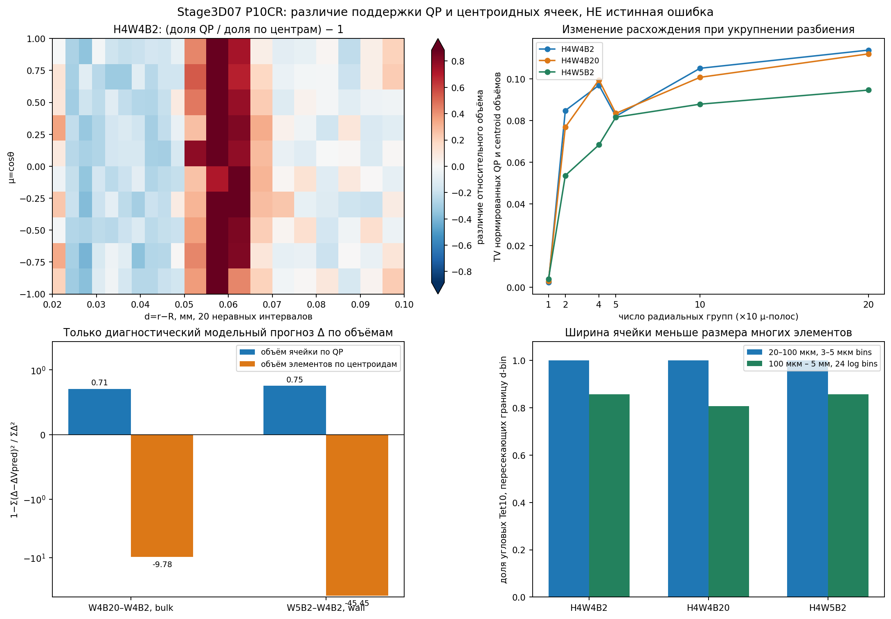

# Stage3D07 / P10CR — влияет ли отнесение элементов к узким радиальным ячейкам на наблюдаемые полярные разности?

**Дата:** 21.11.2026. **Результат:** `P10CR_OFFLINE_SUPPORT_BINNING_AUDIT_OK_NO_FEM`. Независимый SHA-gated offline-анализ опубликованных P10CI, P10BA, P10CM и P10CQ без нового Windows запуска, Gmsh, `.msh`, FEM и изменения D-017.

## 1. Единственный исследовательский вопрос

В P10CJ уже было достоверно показано: в 20–100 мкм **100%** исходных прямолинейных Tet10 имеют хотя бы один угол за границей узкого 3–5 мкм *центроидного* радиального бина; при подписанном 20→1 радиальном объединении сохраняется только 8.6553%/11.8595% от fine `Σ|Δ|` двух пространственных сравнений. P10CQ позднее показал 80.64–85.77% radial-bin crossing в 100 мкм – 5 мм. Эти предыдущие числа **не повторяются как новые результаты P10CR**.

Новый P10CR сравнивает для трёх исходных сеток в 20–100 мкм при `t=900s` два уже опубликованных набора объемов: `V^corner_K` — сумма прямолинейных объёмов элементов, целиком отнесённых к ячейке **по центру четырёх углов** (P10CI), и `V^QP_K` — интегральный объём, распределённый по положению квадратурных точек (P10BA). Эти подходы намеренно не смешиваются: `V^corner` не является точной геометрической интеграцией отсечённой подобласти. Криволинейная Tet10 геометрия также может влиять на разницу `V^QP−V^corner`.

Поскольку `ΣV^QP/ΣV^corner` за исследуемый слой по трём сеткам равно 0.979699/0.970827/0.969601, сравниваются **нормированные формы распределений**:

\[
p_K=V_K^{QP}/\sum_J V_J^{QP},\quad c_K=V_K^{corner}/\sum_J V_J^{corner},\quad TV=\frac12\sum_K |p_K-c_K|.
\]

Это геометрический диагностический индекс, **не физическая ошибка FEM, не корректировка сопряжённого градиента, не чистая оценка binning artefact**, так как исходные правила интегрирования также различаются.

## 2. Первичные источники и независимые гейты

- P10CI 600 `(mesh,radial,μ)` straight-corner geometry CSV SHA `db22675c116b1d151e86c73726cc4e2aeba21bcb4c41c099ee4e5d2e4d3e9f61`.
- Три оригинальные P10BA 400-row CSV (из каждого выбрано **ровно 200 при `time_step=6`, `t=900s`**): H4W4B2 SHA `219b237e42305f1e4db3089f6501bdd59034dc664f9eee83c5bdc0888e15d447`; H4W4B20 SHA `3803ed656045384727109952c9331c4e073e4cec9f718a3a7770ecf3a28bd1be`; H4W5B2 SHA `8ad499250082e919942e8ea105ed0b21463cfd5083085af3f004ee293294c11c`.
- P10CM 200 signed delta + multiscale CSV SHA `428a1d3b1d7b84e10a6c44762f0222c831a5f917283c872e06eaa11eff0781eb`; P10CQ far B6 JSON SHA `33ed65373f828475ff0a964f17273845faefb20a2346039ead352b151ba6961a`.
- Все 6/6 file SHA gates PASS. Полные ключи 20 радиальных ×10 μ без дублей на каждой сетке; **важно**, поле `radial_subbin` в P10BA сбрасывается к нулю в каждом из двух shell, поэтому независимый join выполнен по *глобальным фактическим radial_lower_mm*, а не по этому локальному индексу. Подписанные P10CM `Δ_bulk/Δ_wall` воспроизведены из двух P10BA mechanical totals с допуском 2×10⁻¹³, exact joins PASS. Test TV monotonicity по действительно вложенным радиальным разбиениям PASS.

## 3. Новое измеренное расхождение объемной поддержки

Агрегация сначала **суммирует объёмы по соседним радиальным клеткам без взятия модуля**, после чего обе нормированные меры и `TV` оцениваются на общей укрупнённой сетке. Угловые 10 μ-полос сохраняются. При `20` radial сохраняются 200 fine клеток, при `2` — исходные 20–50/50–100 мкм, при `1` — общий слой 20–100 мкм.

| Исходная сетка | 20×10 fine `TV` | 2×10 `TV` | 1×10 `TV` | Доля полюсов μ0/9 в fine `Σ|p−c|` |
|---|---:|---:|---:|---:|
| H4W4B2 | **11.3857%** | 8.4835% | **0.2279%** | 19.1160% |
| H4W4B20 | **11.2045%** | 7.6846% | **0.2899%** | 18.4784% |
| H4W5B2 | **9.4652%** | 5.3630% | **0.3929%** | 20.0399% |

**Интерпретация:** при fine radial ячейках пространственная поддержка QP и отнесение объёмов по центроидам могут заметно различаться. Их *общая угловая распределённость* на объединённом радиальном слое, однако, отличается менее чем на 0.4% по `TV`. Такое перераспределение преимущественно связано с радиальным разрешением описательных ячеек; разница криволинейной QP геометрии от угловых тетраэдров не исключена.

В то же время на два полярных μ-пояса приходится только **18.48–20.04% самой величины геометрического fine `Σ|p−c|`**, близко к 20% телесного угла. Для наблюдавшихся P10CH signed-mechanical spatial сравнения H4W4B20 bulk / H4W5B2 wall соответствующая полярная доля **`Σ|ΔI|`** равна 87.0058% / 87.7966%. Поэтому обнаруженная существенная неоднозначность radial-bin support **сама по себе не демонстрирует систематической полярной концентрации**, достаточной для объяснения механического эффекта.

## 4. Контроль через подписанные механические вклады, без «корректировки» физики

Как диагностический контрфактический *volume-only* predictor вычислено `ΔVpred_K=Ibase_K (Valt_K/Vbase_K−1)`, где `Ibase` — опубликованный подписанный mechanical integral в t900. При использовании `V^QP_K` uncentered `1−Σ(Δ−ΔVpred)²/ΣΔ²`=**0.708288** bulk и **0.753198** wall (результат P10CJ независимо воспроизведён). Если вместо QP ошибочно использовать **центроидный** `V^corner_K`, показатель станет **−9.780769** bulk и **−45.450542** wall: для fine bins такой predictor хуже нулевого прогноза. Это **не** качество или точность исходного adjoint и не допустимая поправка; сравниваются только две намеренно упрощённые диагностические модели.

Ранговая корреляция между `|ΔI|` и размером исходного `|p−c|` по 200 cell: −0.0359 bulk и +0.0293 wall. После ранжирования внутри фиксированной μ-полосы +0.0334 и +0.1373. Эти наблюдаемые связи слабы и **не** указывают на доказанный источник больших полярных производных.

Данные и воспроизведение: `research/proposals/P10CR_CENTROID_VS_QP_SUPPORT_20261121/p10cr_centroid_vs_qp_support_offline.py` SHA `72d67391b8f0d62f539555d04e77bd139cd0b178ac21c4cf2eb6d0a90b187364`; JSON `P10CR_OFFLINE_SUPPORT_BINNING_AUDIT.json` SHA `c559b2b2fc9876f8fbd22181dd985ef257de762fc5176ca00f54844d676dd2df`; PNG SHA `5a7e324913fca2c1681ceb65be0f8a4a30b23a2b759ff8d7ab08412204e5f667`. Источники уже опубликованы в P10CI/P10BA/P10CM/P10CQ input/derived папках. Скрипт только читает и SHA-gates, формирует новые JSON и научный рисунок; FEM=0, Gmsh=0, новая M1 `.msh` не создана.

## 5. Состояние механизма и следующий малый этап P10CS

**Закрытый вопрос P10CR:** насколько велико несовпадение мелкоячеечной QP-поддержки и центроидной карты геометрического объёма? Ответ: `TV~9.5–11.4%` fine, `<0.4%` после объединения по радиусу, и **нет соответствующей полярной направленности** индекса. Это подтверждает необходимость осторожно интерпретировать signed `D_R` локально и **не** строить адаптивную M1 по одной шумной 3–5µм `Σ|Δ|` карте. Не установлено, является ли разница QP/centroid причиной какой-либо части *истинной* ошибки shape-adjoint; для этого нет element-level per-QP физических вкладов и референтной сходимости.

**Следующий единственный P10CS, без нового Windows/FEM:** использовать существующие **QP механические** P10BA `explicit`, `equilibrium`, `history` по т900 и `V^QP` для сравнения полярных и экваториальных плотностей вклада `I_K/V_K` в рамках тех же 20–100мкм, с независимым замыканием механических компонент и контролем знаков/радиального объединения. Это может отличить концентрацию signed mechanical *density* от плотности ячеек, но не восстановит отсутствующие thermal/φ/t поля и не докажет происхождение истинной ошибки. D-017 неизменно; новый physical M1/FEM только по отдельному разрешению.
