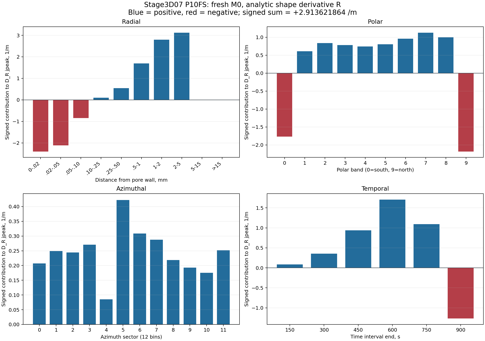

# P10FS — полная физика новой M0 и выпуск рецепта M0→M1

Дата 2026-11-22. Исследовательская ветка
`research/p10bb-w5b2-20261118`. Следование P10FP→P10FQ→P10FR.

## Источник и физический паспорт

Принят `P10FN_M0_R_PHYSICS_EVIDENCE.zip` SHA256
`b5191c4f23a2a07f09b6615c52d258c119f891813e85d789fac63209710a48f4`.
M0 MSH SHA256
`926a9c903765ce77fd560300d10614d3cece3d4cd4d7813027e45e92d33870d6`
побайтно соответствует P10FQ Geometry GO.

- User Windows11, MinGW: `C:\mingw64\bin\g++.exe`;
  compiled EXE SHA256 `381302503da0bfff21e2f3036fee8da9daa840ed032706af28423d638a48b210`.
- `R`, EDV_VAR, ξ=0, B6=5 mm, 6×150 s (t_end 900s),
  4 потока, 7992 Tet10 / 11699 узлов, исходный Tri6 поры 160;
  median pore edge 0.418921 mm.
- **Одна новая прямая** + **18 аналитических сопряжённых решений**
  на той же M0; central FD geometry evaluations=0;
  forward history locally saved SHA256
  `add074b91271f43e781ac62aa6f66878dc54670ee6455d624878ee2b50fe8708`.
- Native solver exit0, wall128.762384 s, polled private peak1,056,518,144 B,
  stop_reason пуст, independent 4D audit PASS.
- Newton relative residual на t900 1.884878e−11;
  максимум механической equilibrium проверки jpeak 8.279195488e−8,
  максимум thermal equilibrium по трём функционалам
  4.973042264e−11; preflight/parity в логе PASS.

**Важно:** фактическая полная история хранится на компьютере пользователя;
в evidence ZIP содержатся подписанные CSV и её SHA256, а не большие
байты `forward_history.bin`. Независимая проверка history SHA возможна
только при наличии локального бинарного файла у пользователя.

## Все три основные аналитические производные

| Функционал | Значение J | Механический D_R | Тепловой D_R | Полный D_R, м−1 |
|:--|--:|--:|--:|--:|
| j6 | 0.0021779682072 | +0.0239372339333 | +0.0023395365988 | **+0.0262767705321** |
| jpeak | 0.0480303413179 | +2.848340199240 | +0.0652816648194 | **+2.913621864059** |
| jen | 0.000872622216630 | +0.0159410032439 | +0.000599466697716 | **+0.0165404699416** |

Для `jpeak` механическая сумма сама возникает из **крупных
компенсирующих компонентов**:

- явный вклад формы целевого функционала **−15.3924587131875 м−1**;
- вклад равновесного остатка **+14.2620474316538 м−1**;
- внутренней истории EDV **+3.9787514807734 м−1**;
- механическая сумма **+2.8483401992396 м−1**;
- тепловая сопряжённая **+0.0652816648194 м−1**;
- полный `jpeak` **+2.9136218640590 м−1**.

Большая компенсация означает необходимость точного контроля знаков
и чувствительности к сетке; сама по себе не является численной ошибкой.

## Независимое signed-4D замыкание

Повторён `P10FN_physics_audit.audit` на исходных CSV: ровно 7206 строк,
6×1200 различных `(r,mu,phi)` ячеек объёма и 6 top Robin, единый
режим M0/R, счётчик QP на каждом шаге 7992×27 мех. и 7992×64 терм.,
полные суммы mechanical/thermal/time/region совпадают с
`P10W_COMPONENTS`, `P10W_STEP_COMPONENTS`, `P10W_ANALYTIC_ADJOINT`.
Контроль вычислен заново и **PASS**, а не принят из одного поля manifest.

Независимая группировка всех 4D строк по каждому направлению
(воспроизводимый исходник `scripts/p10fs_analyze_fresh_m0_physics.py`,
детальный JSON в `research/evidence/P10FS_FRESH_M0_R_20261122/derived`):

| Интервал времени, с | signed jpeak D_R, м−1 |
|:--|--:|
| 0–150 | +0.086867366 |
| 150–300 | +0.356187520 |
| 300–450 | +0.937101415 |
| 450–600 | +1.705323933 |
| 600–750 | +1.095410095 |
| 750–900 | **−1.267268464** |
| **Сумма** | **+2.913621864** |

### Пространственная структура

Подписи radial `d` — расстояние от стенки поры:

| d, мм | signed jpeak D_R, м−1 |
|:--|--:|
| 0–0.02 | −2.397460 |
| 0.02–0.05 | −2.111045 |
| 0.05–0.10 | −0.839945 |
| 0.10–0.25 | +0.103643 |
| 0.25–0.50 | +0.542208 |
| 0.50–1.00 | +1.695881 |
| 1.00–2.00 | +2.796618 |
| 2.00–5.00 | +3.123722 |
| d>5 | 0 (вырезанная область B6) |

Полярные крайние полосы `mu_bin=0` (юг) и `mu_bin=9` (север)
дают **−1.770131 и −2.183720 м−1** по всему B6; средние
полярные пояса — в основном положительные. В полярных крайних поясах
на расстоянии d≤0.5mm signed вклад в совокупности **−5.1757733453 м−1**,
когда глобальный D_R=+2.9136218641. Положительные вклады иных зон
сильно компенсируют отрицательные полярные. На последнем шаге времени
знак также меняется. Все 12 азимутальных секторов представлены;
их signed интегралы заметно различаются, но **требовать их равенства
не предусмотрено алгоритмом**.

Эти наблюдения являются фактической **локализацией вкладов**, но
не доказывают причинность сеточной анизотропии и не дают количественной
погрешности без дальнейших согласованных полных расчётов M1,M2… .

## Решение: GO для построения M1

**M0 PHYSICS PASS.** После полного просмотра M0 разрешается
следующий отдельный *mesh-only* шаг: строго равномерное целевое
уменьшение характерного объёма для M0→M1 на 20%:

`kappa_0(x) ≡ 1`, `alpha_0 = 0.20`,  
`h_1(x)=h_0(x) * (1-0.20)^(1/3)`.

Это означает **целевое** `h1/h0≈0.9283177667` по всему объёму,
`Veff_target(M1)/Veff_target(M0)=0.80`, но Gmsh перестраивает
топологию и не гарантирует точное 20%-ное уменьшение каждого
фактического элемента или пространственного QP-бина. Итоговые
при-полюсные 343/729QP Veff и смежные q необходимо независимо
проверить после генерации M1. Для M0→M1 не навязываем заранее
локальное поле по `jpeak`, чтобы сохранить контрольный однородный шаг.

Выдан SHA-прикреплённый единственный рецепт
`research/recipes/P10FS_FROM_REAL_M0_WINDOWS_20261122/ACTIVE.json`.
Пользователь копирует этот файл **только** в
`G:\ildar\Stage3D07\P10FP_TOOLS_R4\recipes\ACTIVE.json`
взамен исходной заглушки и запускает уже имеющуюся кнопку
`01_GENERATE_NEXT_MESH.cmd`, без новой установки/компиляции и без FEM.
Она сохранит M1.geo и M1.msh под `meshes` и выдаст
`P10FN_M1_MESH_EVIDENCE.zip` в `LOCAL_RUNS`.

**Нельзя запускать физику M1 до независимого geometry GO и выдачи
`approvals/M1.json`.** После будущей M1-физики впервые выбирать
физически мотивированное локальное κ_1 для M1→M2.
