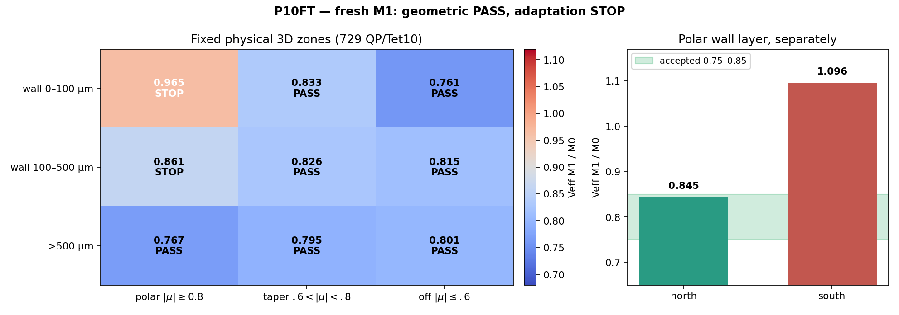

# P10FT — независимая приёмка новой M1: геометрия PASS, адаптация STOP

Дата 2026-11-22. Новая серия P10FP→P10FQ→P10FS→**P10FT**;
исследовательская ветка `research/p10bb-w5b2-20261118`.

## Однозначное решение

**`GEOMETRY_QP729_PASS / D025_LOCAL_VOLUME_STOP / M1_PHYSICS_NOT_APPROVED`.**

Предоставленная исследователем исходная M1 не имеет отрицательных
криволинейных якобианов Tet10 и правильно реализует выпущенный
однородный рецепт α=0.20. Но в фиксированной физической области
`d=0–100 мкм`, `|μ|≥0.8` фактический характерный объём при южном
полюсе **увеличился на 9.59%**, хотя рецептом запрошено уменьшение
на 20%, а действующий адаптационный допуск составляет **15–25%**.
В той же области на севере достигнуто уменьшение на 15.52%.
Агрегирование двух полюсов маскирует нарушение: общий ratio 0.96485.

**Не выдавать `approvals/M1.json`; не запускать физический R на M1.**
Ни Windows FEM, ни новая сетка в ходе независимой проверки не строились.
Результат M0/R из P10FS остаётся действующим, но перенос его в
продолжение M1→M2 без успешного сеточного шага недопустим.

## Фиксация оригинальных входов и воспроизводимость

| Объект | SHA-256 / идентификатор |
|:--|:--|
| Оригинальный `P10FN_M1_MESH_EVIDENCE.zip` | `9a4e91c65397ca41f12ee61487f2d21a90c0ba78fe5bf0ed1dff435059384fc4` |
| Принятый ранее `M0.msh` | `926a9c903765ce77fd560300d10614d3cece3d4cd4d7813027e45e92d33870d6` |
| Исходный `M0.geo` | `ac6981b04d205cc00bf50ddbaf6722c884af7189ef4e3e743253c754f69e62aa` |
| Новая `M1.msh` | `f281d253571db095b90790326f503dfa3f6fe3a1dc5cb5c904fca2787dfe4275` |
| Новая `M1.geo` | `968ef2ed3f64160d51d1983ead31216758d164fa665fa7e6a9044f8fc04d64e8` |
| Пришедший `RECIPE.json` | `0d0a77df2d49b167c9127fe42bf31e20a6fb47ad812031da12f2d313593a647b` |

Raw ZIP и MSH пользователя **приватны и не публикуются**. Публикуются
только настоящий отчёт, воспроизводимый код и производные числа/фигура.
Оригинальный рецепт `RECIPE.json` побайтно совпадает с
`research/recipes/P10FS_FROM_REAL_M0_WINDOWS_20261122/ACTIVE.json`.
Канонически сгенерированный из M0 GEO и этого рецепта текст M1 GEO
совпадает с фактическим M1 GEO с учётом переносов строк Windows.
Подмена исходной сетки или неверный рецепт не объясняют результат.

Windows Gmsh 4.15.2: один native `-3`, exit0, 0.6012 с;
QA27 exit0, FEM=0. 14663 узла, **10048 Tet10**, 178 Tri6
поры, физические surface tags 2–9. Для сравнения M0:
11699 узлов, 7992 Tet10, 160 Tri6 поры.

## Геометрическая независимая QA

- Вновь выполнен интеграл по **271296** 27QP: неположительных detJ **0**,
  минимум detJ **1.688235359934×10⁻¹¹**, объём
  **1.799958135515786×10⁻⁴ м³**.
- Объём M0 **1.799958140411268×10⁻⁴ м³**; фактическая
  глобальная средняя `(V1/N1)/(V0/N0) = 0.7953821634`.
  **Глобальное требование выполнено**, но не заменяет локальное.
- Вне зависимости от штатной QA проверены детерминанты
  во всех **343 и 729 QP на каждый Tet10**. На 729QP:
  **все положительны**, минимальный detJ M1
  **1.684880179491×10⁻¹¹** (для M0 **2.423557255189×10⁻¹¹**).
- Для соседних Tet10 в приполярной области p95 отношения
  характерных размеров **улучшился**: M0 1.35120 → M1 1.32659,
  но хвост **ухудшился**: p99 **1.49907 → 1.63508**, max
  **1.59142 → 1.78191**. Счётчики 337→387 пар, `q>1.25`:
  52→60. Это диагностика, не новый порог отказа.

**Вывод:** геометрическая интегрируемость/невырожденность подтверждена
высокими квадратурами; цель локального шага сгущения *не подтверждена*.
Не считать M1 «нельзя вообще считать физику»: математически FEM
потенциально возможен, однако именно научный протокол Stage3D07
не допускает такую M1 к сравнительным физическим расчётам.

## Фиксированные физические объёмы, Tet10 curved QP

Использовано правило P10ED/P10ER на **тех же пространственных областях**,
не сопоставление независимых элементов один-к-одному:

\[
V_{\mathrm{eff}}(Z;M)=
\frac{\int_Z \mathrm dV}
     {\int_Z (\mathrm dV/V_T(x))},\qquad
Q(Z)=V_{\mathrm{eff}}(Z;M1)/V_{\mathrm{eff}}(Z;M0).
\]

Здесь `V_T` — полный интегрированный curved объём Tet10,
а принадлежность точки области `Z` задаётся координатами
квадратурных узлов; 729QP — порядок **9×9×9**.
Для однородного `κ=1` требуется `0.75 ≤ Q ≤ 0.85`
в приоритетной полярной области, **по каждому полюсу отдельно**.

| QP/Tet10 | Север, d≤100 мкм | Юг, d≤100 мкм | Оба полюса |
|--:|--:|--:|--:|
| 27 | 0.815527 | **1.121005** | **0.956516** |
| 125 | 0.840859 | **1.091620** | **0.961068** |
| 343 | 0.842912 | **1.096516** | **0.963445** |
| **729** | **0.844779 PASS** | **1.095906 STOP** | **0.964846 STOP** |

Изменение Q от 343→729QP максимум **0.00186743**,
что много меньше величины нарушения южной полярной области.
Суммарный *сам фиксированный физический* приполярный объём
M1/M0 **0.9980565**, т.е. сбой не вызван сдвигом объёма зоны.

### Девять зон по радиусу и полярности (729QP)

Каждая ячейка — `Veff(M1)/Veff(M0)`; PASS означает попадание в
ориентировочную однородную полосу 0.75–0.85, STOP — вне её.
**Север/юг за этой таблицей также проверяются отдельно**.

| Расстояние d от поры | Полярная, \|μ\|≥.8 | Переходная, .6–.8 | Вне полярной, ≤.6 |
|:--|--:|--:|--:|
| 0–100 мкм | **0.964846 STOP** | 0.833091 PASS | 0.760621 PASS |
| 100–500 мкм | **0.861037 STOP** | 0.826341 PASS | 0.815248 PASS |
| >500 мкм | 0.766852 PASS | 0.794869 PASS | 0.800735 PASS |

### Проверка согласованности поровой Tri6-поверхности

Это **диагностика возможной связи** поверхностного remeshing с
локальной объёмной плотностью; не суррогат основного D-025 теста.
Для каждого порового Tri6 взята медиана длин трёх corner-edge.

| Полярная сторона | M0 Tri6 / edge median | M1 Tri6 / edge median |
|:--|:--|:--|
| Север μ≥0.8 | 18 / 0.442314 мм | 19 / 0.390181 мм |
| Юг μ≤−0.8 | 20 / 0.379621 мм | 19 / **0.395280 мм** |

У южного полюса медианная поверхность укрупнилась примерно на
**4.1%**; это согласуется с объёмной аномалией, но само по себе не
доказывает уникальную причину: Gmsh пересобирает поверхностные узлы
и объемную топологию нелинейно при изменении предписанного h.
Всеми этими числами запрещено подменять целевой показатель
`Veff` или вводить требование равномерности по азимуту.

## Что делать дальше

1. **Сохранить** исходную M0, неуспешную M1, логи, evidence ZIP,
   опубликованный рецепт и локальный one-shot marker. Это
   проверяемое доказательство отказа, ничего не удалять.
2. Сначала **source-only** спроектировать новое локально
   корректируемое C¹ поверхностно-объёмное поле размеров от
   принятой M0, с контролем полярной Tri6 и прилегающей Tet10.
   Учесть, что рецепт `κ=1` глобально даёт правильные 20% лишь
   по общей средней; первичный южный полярный gate не пройден.
3. Для корректировки **не перезаписывать/переиспользовать**
   `M1.geo`, `M1.msh`, `recipes/ACTIVE.json` или прежний
   `01_GENERATE_NEXT_MESH.cmd` в существующем run. Готовить
   новую версионированную кандидатную mesh-only попытку
   (например, `M1B_CANDIDATE`) с собственными именами файлов,
   строгим SHA-pin M0 и отдельной one-shot блокировкой.
4. Только после получения и **независимой 343→729QP проверки**
   нового кандидата, при необходимости повторив процедуру, можно
   издать разрешение для его физического R и перейти к свежим
   forward+adjoint на одной и той же согласованной сетке.

## Материалы

- Исходник read-only:
  `scripts/p10ft_verify_fresh_m0_m1_spatial.py`;
  требует проверенные оригинальные M0/M1 с точными SHA.
- Полный JSON 27/125/343/729QP и 9 зон:
  `research/evidence/P10FT_FRESH_M1_20261122/derived/P10FT_FRESH_M0_M1_FIXED_3D_729QP.json`.
- Поясняющий рисунок:
  `research/evidence/P10FT_FRESH_M1_20261122/derived/P10FT_M1_LOCAL_ADAPTATION_STOP.png`.
- На пользовательской Windows **ничего повторно не запускалось**;
  `approvals/M1.json` отсутствует по результату научного STOP.
